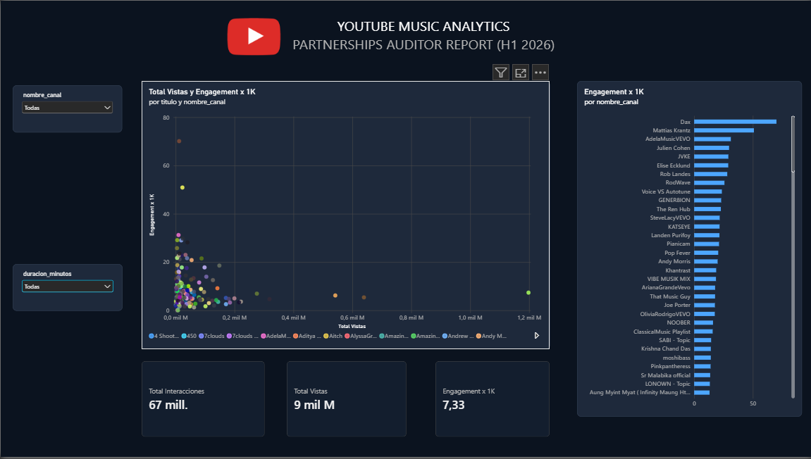

# YouTube Music Analytics & Partnerships Audit

Pipeline integral de analítica e ingeniería de datos: extracción automatizada mediante YouTube Data API v3, ingesta relacional defensiva y modelado en SQL Server (T-SQL), junto con el desarrollo de un panel de auditoría analítica en Power BI Desktop.

---

## 1. Arquitectura del Proyecto

```text
youtube-partnerships-analytics/
├── .gitignore
├── README.md
├── assets/
│   └── dashboard.png
├── data/
│   └── raw_youtube_music_2026.csv
├── pbix/
│   └── YouTube_Analytics_Partnerships.pbix
├── pipeline/
│   └── 01_extract_youtube_api.py
└── sql/
    ├── 1_create_db.sql
    ├── 02_create_staging_table.sql
    ├── 03_normalize_and_deduplicate.sql
    ├── 04_stored_procedures.sql
    ├── 05_channel_performance.sql
    ├── 06_segmentacion_formato_engagement.sql
    ├── 07_auditoria_anomalias_partnerships.sql
    └── 08_ejecutar_reportes_audit.sql
```

---

## 2. Extracción e Ingesta de Datos (Python + YouTube API)

El script `pipeline/01_extract_youtube_api.py` realiza la ingesta paginada consumiendo directamente la **YouTube Data API v3**:

* **Endpoints y Criterios:**
  * `search.list`: Segmentación por categoría musical (`videoCategoryId = 10`), filtrando publicaciones del primer semestre de 2026 (`2026-01-01` a `2026-06-30`).
  * `videos.list`: Obtención de métricas numéricas exactas (`viewCount`, `likeCount`, `commentCount`) y duración en formato ISO 8601.
* **Transformación y Parsing:** Conversión de duraciones ISO 8601 (`PT#M#S`) a segundos enteros con la librería `isodate`.
* **Capa Staging:** Persistencia directa en `data/raw_youtube_music_2026.csv` con codificación `utf-8-sig` para admitir caracteres multilingües y caracteres especiales.
* **Seguridad de Credenciales:** Manejo de la clave de autenticación mediante variables de entorno (`os.getenv("YOUTUBE_API_KEY")`) para evitar la exposición de tokens en repositorios públicos.

```bash
# Ejecución del pipeline de extracción
python pipeline/01_extract_youtube_api.py
```

---

## 3. Modelado y Calidad de Datos (SQL Server)

El flujo de scripts T-SQL en `/sql` está estructurado de manera secuencial para garantizar idempotencia y tolerancia a fallos:

1. **`1_create_db.sql`**: Creación y configuración inicial de la base de datos `YouTubeAnalytics2026`.
2. **`02_create_staging_table.sql`**: Definición de la tabla temporal `raw_youtube_videos_2026` con tipos de datos permisivos para evitar rupturas de carga.
3. **`03_normalize_and_deduplicate.sql`**: 
   * Limpieza y casteo seguro usando `TRY_CAST` sobre tipos numéricos (`BIGINT`, `INT`, `DECIMAL`).
   * Eliminación de duplicados mediante CTE con función de ventana:
     ```sql
     WITH RankedVideos AS (
         SELECT 
             TRY_CAST(video_id AS NVARCHAR(50)) AS video_id,
             TRY_CAST(titulo AS NVARCHAR(255)) AS titulo,
             TRY_CAST(nombre_canal AS NVARCHAR(150)) AS nombre_canal,
             TRY_CAST(vistas AS BIGINT) AS vistas,
             TRY_CAST(likes AS INT) AS likes,
             TRY_CAST(comentarios AS INT) AS comentarios,
             ROW_NUMBER() OVER (
                 PARTITION BY video_id 
                 ORDER BY TRY_CAST(vistas AS BIGINT) DESC
             ) AS rn
         FROM dbo.raw_youtube_videos_2026
     )
     INSERT INTO dbo.tbl_videos_musicales
     SELECT video_id, titulo, nombre_canal, vistas, likes, comentarios
     FROM RankedVideos
     WHERE rn = 1;
     ```
4. **`04_stored_procedures.sql`**: Definición del procedimiento analítico parametrizado `dbo.sp_auditoria_partnerships_2026`.
5. **`05_channel_performance.sql`**: Agregaciones históricas y cálculo de promedios consolidados por canal.
6. **`06_segmentacion_formato_engagement.sql`**: Categorización por formato de duración (`Dinámico < 5 min` vs `Largo > 5 min`).
7. **`07_auditoria_anomalias_partnerships.sql`**: Detección de patrones anómalos comparando el volumen individual de cada contenido contra el promedio de vistas de su propio canal:
   ```sql
   AVG(vistas) OVER (PARTITION BY nombre_canal) AS promedio_vistas_canal
   ```
8. **`08_ejecutar_reportes_audit.sql`**: Ejecuciones parametrizadas del reporte de auditoría:
   ```sql
   -- Reporte general sobre contenidos con más de 5.000 vistas
   EXEC dbo.sp_auditoria_partnerships_2026 @min_vistas = 5000, @solo_alertas = 0;

   -- Aislamiento de contenidos con alerta de tráfico inflado
   EXEC dbo.sp_auditoria_partnerships_2026 @min_vistas = 5000, @solo_alertas = 1;
   ```

---

## 4. Lógica de Negocio: Detección de Anomalías

Para auditar acuerdos comerciales y alianzas estratégicas (Partnerships), se normalizó la tasa de conversión comunitaria calculando el número de interacciones relativas por cada 1.000 reproducciones[cite: 4]:

$$\text{Engagement x 1K} = \frac{(\text{Likes} + \text{Comentarios}) \times 1000}{\text{Vistas}}$$

### Criterios de Clasificación:
* **Alerta: Tráfico Alto / Baja Retención:** Videos con reproducciones superiores al promedio histórico de su canal, pero con un ratio menor a 20 interacciones por cada 1.000 vistas (`Engagement x 1K < 20.00`). Señaliza tráfico pasivo, reproducción en bucle o audiencias de baja fidelidad.
* **Top Engagement Orgánico:** Videos con un ratio igual o superior a 60 interacciones por cada 1.000 vistas (`Engagement x 1K >= 60.00`), evidenciando alta conversión activa y respuesta comunitaria.
* **Comportamiento Normal:** Contenidos alineados a los patrones regulares del catálogo.

---

## 5. Dashboard Ejecutivo (Power BI Desktop)

Tablero interactivo diseñado bajo estándar Dark Mode, optimizado para cruzar el alcance masivo de reproducciones contra la retención real de usuarios[cite: 4]:



### Medidas DAX Implementadas:
```dax
Total Vistas = SUM(tbl_videos_musicales[vistas])

Total Interacciones = SUM(tbl_videos_musicales[likes]) + SUM(tbl_videos_musicales[comentarios])

Engagement x 1K = DIVIDE([Total Interacciones] * 1000, [Total Vistas], 0)
```

### Componentes de Visualización:
* **Tarjetas KPI:** Resumen general de `Total Interacciones`, `Total Vistas` y promedio de `Engagement x 1K`[cite: 4].
* **Gráfico de Dispersión Cuadrante:** Detección visual de anomalías cruzando `Total Vistas` contra `Engagement x 1K`[cite: 4].
* **Ranking por Canal:** Gráfico de barras horizontales ordenado por tasa de conversión[cite: 4].
* **Filtros Interactivos:** Segmentación dinámica por canal y rango de duración[cite: 4].

> El archivo `.pbix` con el modelo relacional, transformaciones y medidas se encuentra disponible para descarga en `Youtube_Analytics/pbix/YouTube_Analytics_Partnerships.pbix`.
